# log_api: backend de autenticación listo para usar

API REST en Ruby on Rails que podés clonar y usar como **backend de
autenticación** para tu frontend web (SPA) o app móvil:

- Registro con email y contraseña, confirmación por email y reseteo de contraseña.
- Login social con **Google, Facebook, GitHub y Twitter** (OmniAuth), pensado
  para SPAs y apps móviles (one-time code + PKCE).
- **Tokens JWT** de acceso de vida corta + **refresh tokens rotativos**. No hay
  cookies de sesión: todo funciona con `Authorization: Bearer`.
- Perfil de usuario (`/profiles`) y cuenta propia (`/me`).
- CORS configurable, rate limiting, errores JSON uniformes, sin enumeración de usuarios.
- **Mini UI de demostración** en `/ui/` (login, registro, confirmación, contraseña
  olvidada, login social y perfil), sin build ni dependencias.

Stack: Ruby 3.2 · Rails 7.0 (`api_only`) · MySQL 8 · Devise + devise-jwt ·
OmniAuth · rack-cors · rack-attack · RSpec.

La referencia completa de la API está en [`docs/openapi.yaml`](docs/openapi.yaml)
(abrila con [Swagger Editor](https://editor.swagger.io) o cualquier visor OpenAPI).

---

## Índice

1. [Puesta en marcha](#puesta-en-marcha)
2. [UI de demostración](#ui-de-demostración)
3. [Configuración (variables de entorno)](#configuración-variables-de-entorno)
4. [Cómo funciona la autenticación](#cómo-funciona-la-autenticación)
5. [Endpoints](#endpoints)
6. [Ejemplos con curl](#ejemplos-con-curl)
7. [Login social desde una SPA o una app móvil](#login-social-desde-una-spa-o-una-app-móvil)
8. [Errores y rate limiting](#errores-y-rate-limiting)
9. [Tests y CI](#tests-y-ci)
10. [Producción](#producción)
11. [Decisiones de seguridad](#decisiones-de-seguridad)

---

## Puesta en marcha

### Opción A: con Docker (sin instalar Ruby ni MySQL)

Requiere Docker con Compose v2.24 o superior.

```bash
git clone <este-repo> log_api && cd log_api
cp .env.example .env          # opcional: claves OAuth, SMTP, etc.
docker compose up --build
```

La API queda en `http://localhost:3000`. En el primer arranque se crea la base y
un usuario demo: **demo@example.com / demo-password-123**.

Los emails (confirmación, reseteo) se guardan como archivos dentro del contenedor:

```bash
docker compose exec app sh -c 'ls tmp/mails && cat tmp/mails/*'
```

### Opción B: local

Requisitos: Ruby 3.2 (ver `.ruby-version`), Bundler y MySQL 5.7+/8.

```bash
git clone <este-repo> log_api && cd log_api
bin/setup            # instala gems, crea .env desde .env.example, crea la base y carga el seed
bin/rails server
```

Si tu MySQL usa usuario/contraseña distintos de `root` sin contraseña, editá
`DATABASE_USERNAME` / `DATABASE_PASSWORD` en `.env` antes de `bin/setup` (o
volvé a correrlo después). Para conectarte por TCP en lugar del socket local,
definí `DATABASE_HOST`.

Las bases se llaman `app_named_poly_development` y `app_named_poly_test`.

Sin `MAILER_USERNAME`, en desarrollo los emails se escriben en `tmp/mails/`.

Prueba rápida:

```bash
curl -s localhost:3000/up
# {"status":"ok"}
curl -s -H 'Content-Type: application/json' \
  -d '{"email":"demo@example.com","password":"demo-password-123"}' \
  localhost:3000/auth/sign_in
```

---

## UI de demostración

El proyecto trae una mini interfaz en **http://localhost:3000/ui/** para probar
todo desde el navegador, sin escribir un frontend:

- Ingresar, crear cuenta, reenviar la confirmación y "olvidé mi contraseña".
- Botones de login social para cada proveedor configurado (OAuth + PKCE).
- Cuenta: perfil (crear y editar), cambiar nombre y contraseña, cerrar sesión
  (en este dispositivo o en todos).
- Los links de los emails de confirmación y reseteo abren la UI, que completa el
  paso sola.

| Ingresar | Crear cuenta | Cuenta creada |
| :---: | :---: | :---: |
| 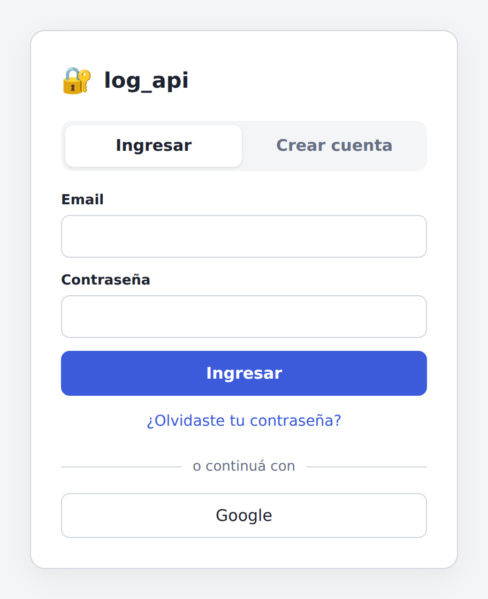 | 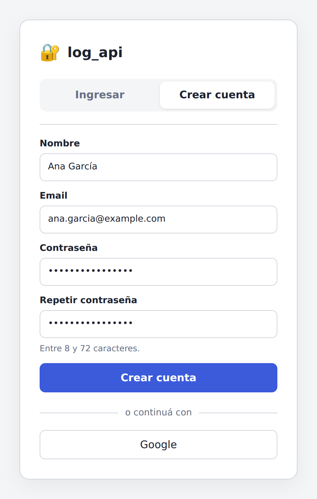 | 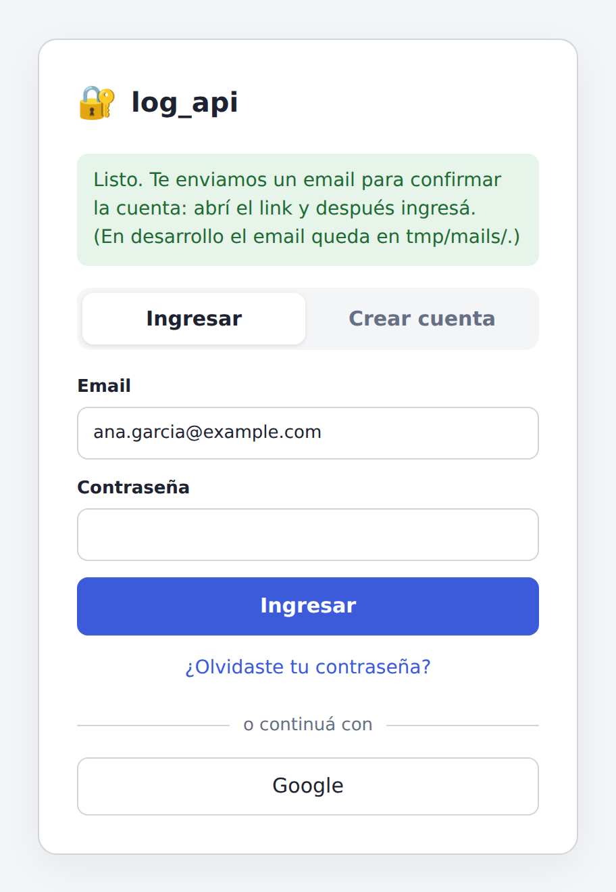 |
| **Falta confirmar el email** | **Email confirmado** | **Olvidé mi contraseña** |
| 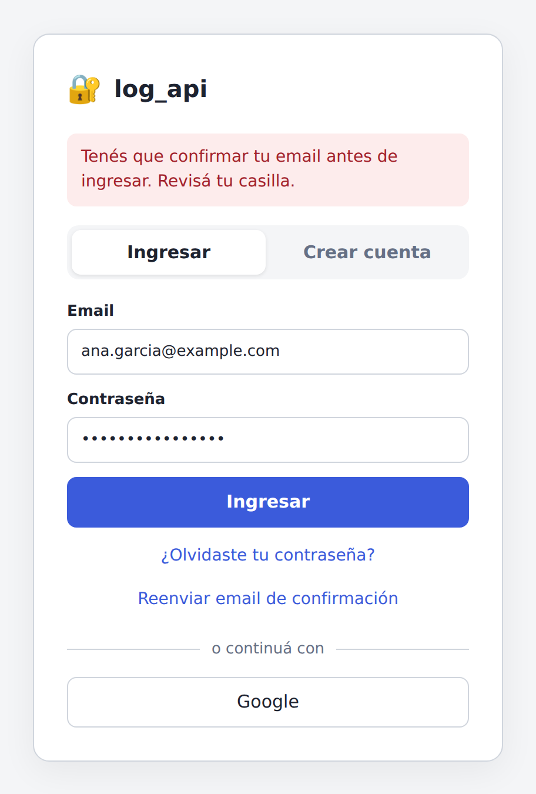 | 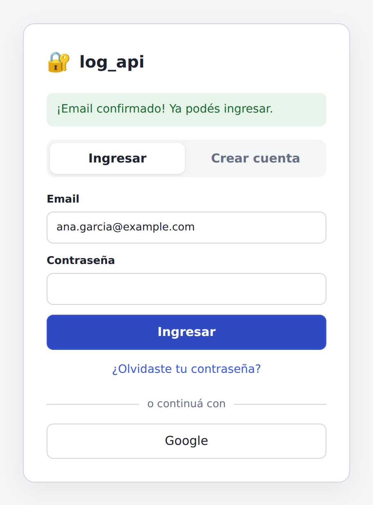 | 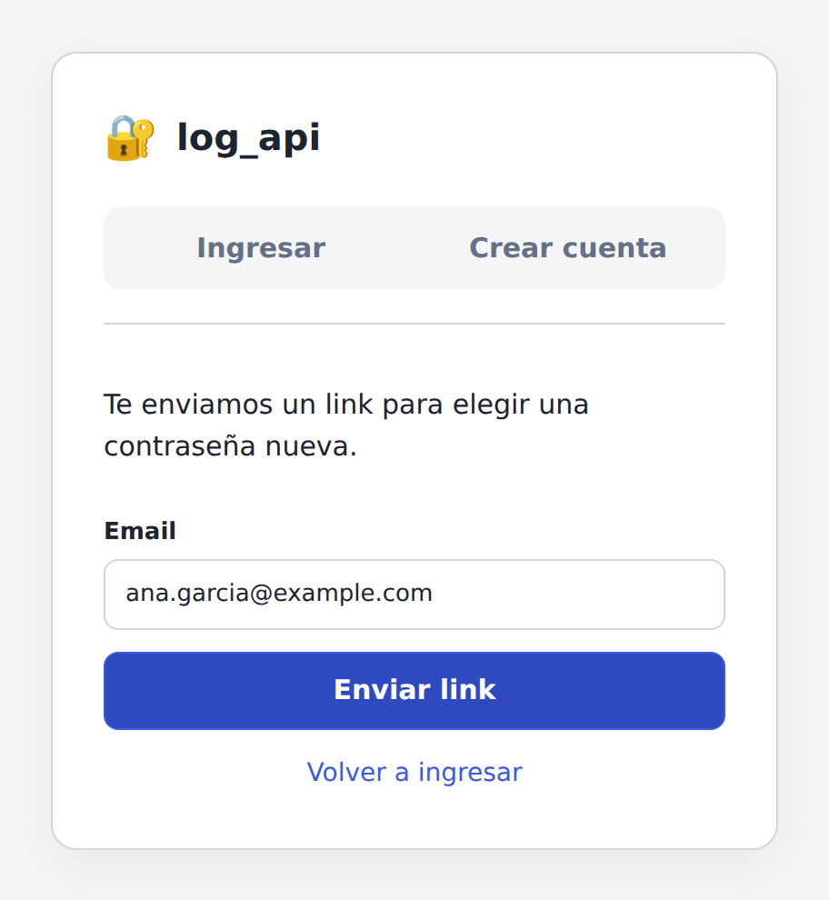 |
| **Cuenta y perfil** | **Ajustes de cuenta** | **Contraseña nueva (link del email)** |
| 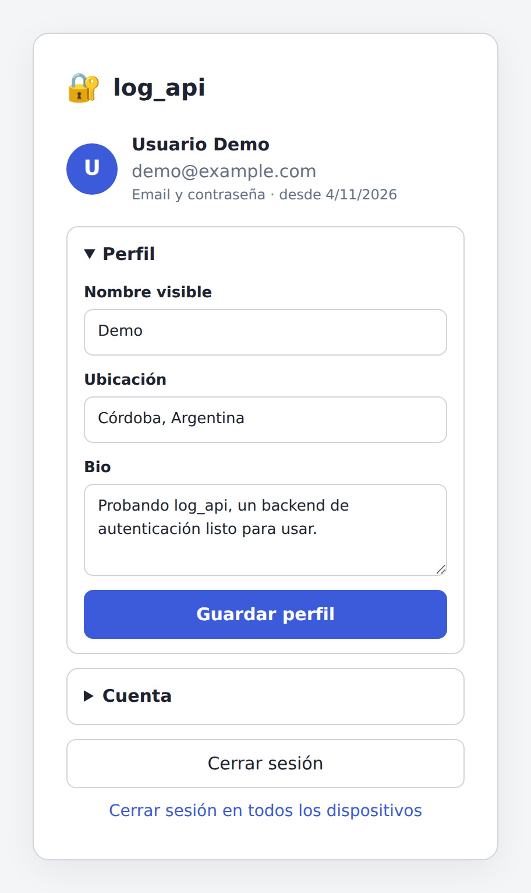 | 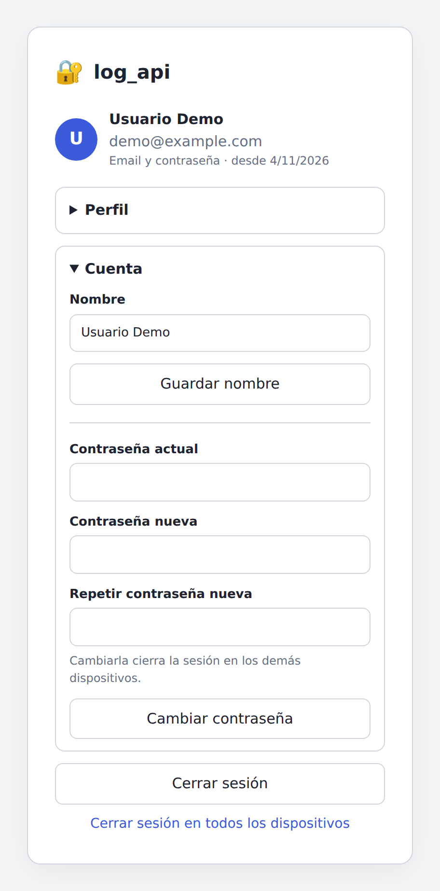 | 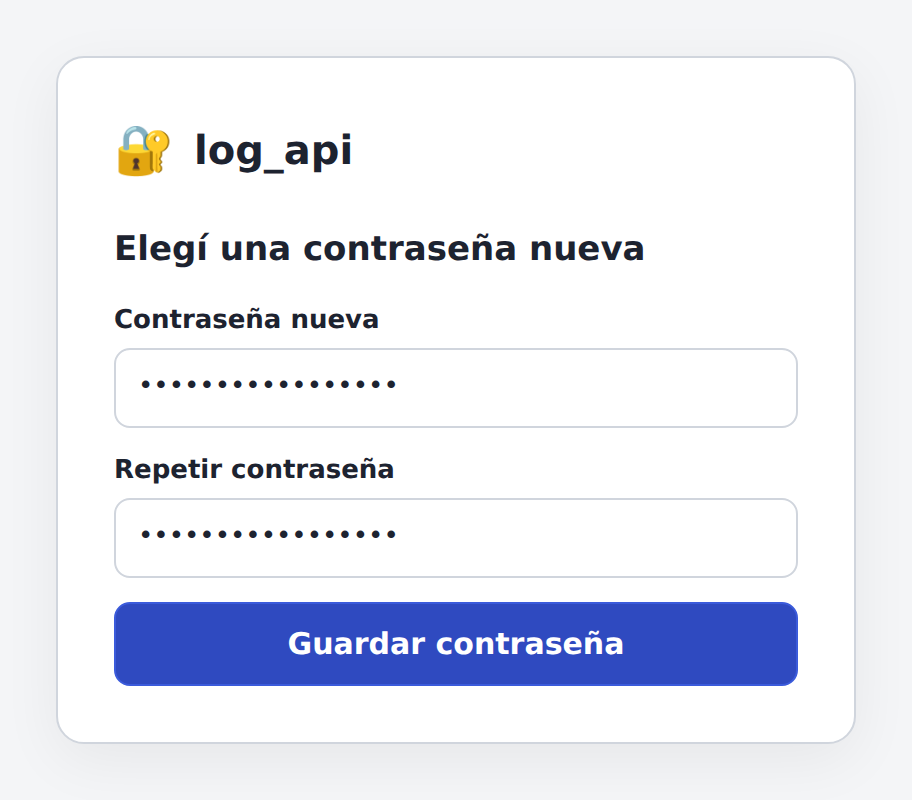 |

También respeta el tema oscuro del sistema:

| Ingresar (oscuro) | Cuenta (oscuro) |
| :---: | :---: |
| 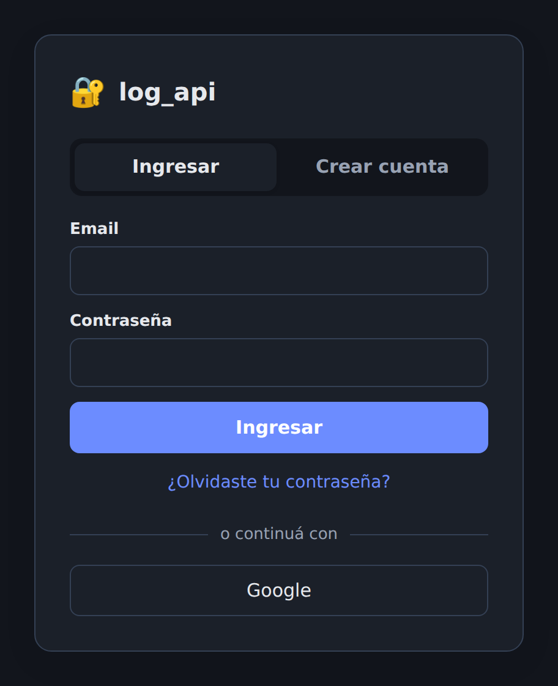 | 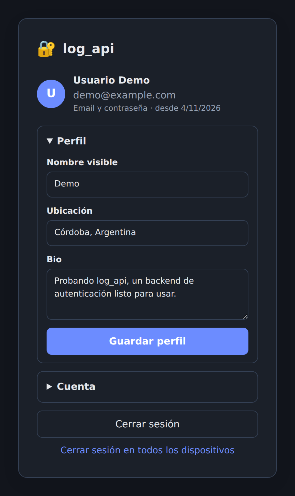 |

Son tres archivos estáticos en [`public/ui/`](public/ui) (HTML, CSS y JS sin
build), servidos por el mismo Rails, así que no hace falta configurar CORS. Sirven
también como ejemplo de cliente: [`public/ui/app.js`](public/ui/app.js) muestra
cómo guardar los tokens, renovarlos con el refresh token y hacer el login social
con PKCE.

**Se activa sola en desarrollo** (`DEMO_UI`, activo por defecto solo en
`development`). Mientras está activa:

- `<API_URL>/ui/` se agrega a `OAUTH_REDIRECT_ALLOWLIST`.
- Si no definiste `CONFIRMATION_URL` ni `RESET_PASSWORD_URL`, los links de los
  emails apuntan a la UI.

Abrila con la misma URL que `API_URL` (por defecto `http://localhost:3000`, no
`127.0.0.1`): el login social compara la URL de vuelta de forma exacta.

En producción está apagada. Para usarla ahí, definí `DEMO_UI=true` y
`RAILS_SERVE_STATIC_FILES=1`. Es una demo: guarda el refresh token en
`sessionStorage`, así que para una app real evaluá cómo lo vas a proteger.

---

## Configuración (variables de entorno)

Todo se configura con variables de entorno. En desarrollo se leen de `.env`
(con `dotenv`); **nunca subas `.env` al repositorio** (está en `.gitignore`).
[`.env.example`](.env.example) tiene todas las variables comentadas.

| Variable | Default | Uso |
| --- | --- | --- |
| `DATABASE_USERNAME`, `DATABASE_PASSWORD` | `root` / vacío | Credenciales de MySQL |
| `DATABASE_HOST`, `DATABASE_PORT` | socket local | Conexión TCP (Docker, CI, base remota) |
| `DATABASE_SOCKET` | `/var/run/mysqld/mysqld.sock` | Socket local si no hay `DATABASE_HOST` |
| `DATABASE_NAME` | `app_named_poly_production` | Nombre de la base en producción |
| `API_URL` | `http://localhost:3000` | URL pública de esta API (links de emails y callbacks OAuth) |
| `FRONTEND_URL` | `http://localhost:5173` | Tu frontend; default de CORS, del reset y del retorno OAuth |
| `JWT_SECRET_KEY` | `secret_key_base` | Clave para firmar los JWT (**obligatoria en producción**; `bin/rails secret`) |
| `JWT_ACCESS_TOKEN_TTL_MINUTES` | `15` | Vida del access token |
| `REFRESH_TOKEN_TTL_DAYS` | `30` | Vida del refresh token |
| `OAUTH_CODE_TTL_SECONDS` | `60` | Vida del one-time code del login social |
| `CORS_ORIGINS` | `FRONTEND_URL` | Orígenes permitidos, separados por coma |
| `OAUTH_REDIRECT_ALLOWLIST` | `FRONTEND_URL/oauth/callback` | URIs **exactas** a las que puede volver el login social (separadas por coma; acepta esquemas móviles como `myapp://oauth/callback`). **Obligatoria en producción** |
| `CONFIRMATION_URL` | vacío | Página de tu frontend para confirmar el email. Vacío: el email apunta a `GET /auth/confirmation` de la API |
| `RESET_PASSWORD_URL` | `FRONTEND_URL/reset-password` | Página de tu frontend para elegir la nueva contraseña |
| `GOOGLE_CLIENT_ID`, `GOOGLE_CLIENT_SECRET` | | Login con Google |
| `FACEBOOK_APP_ID`, `FACEBOOK_APP_SECRET` | | Login con Facebook |
| `GITHUB_CLIENT_ID`, `GITHUB_CLIENT_SECRET` | | Login con GitHub |
| `TWITTER_API_KEY`, `TWITTER_API_SECRET` | | Login con Twitter |
| `MAILER_SENDER` | `no-reply@example.com` | Remitente de los emails |
| `MAILER_ADDRESS`, `MAILER_PORT` | `smtp.mailgun.org`, `587` | Servidor SMTP (cualquiera, no solo Mailgun) |
| `MAILER_DOMAIN`, `MAILER_USERNAME`, `MAILER_PASSWORD` | | Credenciales SMTP |
| `DEVISE_PEPPER` | vacío | Secreto extra para los hashes de contraseña (cambiarlo invalida todas) |
| `SECRET_KEY_BASE` | | Obligatoria en producción |
| `FORCE_SSL` | `true` | Producción: forzar HTTPS (cookies `Secure`, HSTS) |
| `DEMO_USER_EMAIL`, `DEMO_USER_PASSWORD` | `demo@example.com` / `demo-password-123` | Usuario del seed |

Un proveedor social se habilita **solo si sus dos credenciales están definidas**.
`GET /auth/providers` devuelve los que están activos.

### Configurar los proveedores OAuth

En la consola de cada proveedor registrá esta URL de callback (la de la API,
no la de tu frontend):

```
<API_URL>/auth/<proveedor>/callback
# ej.: http://localhost:3000/auth/github/callback
```

| Proveedor | `<proveedor>` | Consola |
| --- | --- | --- |
| Google | `google_oauth2` | Google Cloud Console → APIs y servicios → Credenciales (OAuth client "Web application") |
| Facebook | `facebook` | developers.facebook.com → tu app → Facebook Login → Valid OAuth Redirect URIs |
| GitHub | `github` | GitHub → Settings → Developer settings → OAuth Apps |
| Twitter/X | `twitter` | developer.x.com (OAuth 1.0a). Twitter no suele devolver email, y sin email el login falla |

---

## Cómo funciona la autenticación

```
┌─────────┐  POST /auth/sign_in            ┌─────┐
│ cliente │ ─────────────────────────────▶ │ API │  → { access_token (JWT, 15 min),
└─────────┘                                └─────┘      refresh_token (30 días, un solo uso) }
     │  Authorization: Bearer <access_token>   (cada request)
     │  POST /auth/refresh {refresh_token}     (cuando el access token vence → par nuevo)
     │  DELETE /auth/sign_out                  (revoca el access token y el refresh token)
```

- **Access token**: JWT firmado (HS256) con `sub` (id de usuario), `jti`, `exp`.
  Se envía en `Authorization: Bearer ...`. Al hacer sign out su `jti` queda en
  una denylist (`jwt_denylists`) hasta que vence.
- **Refresh token**: string aleatorio opaco. En la base solo se guarda su hash
  SHA-256. **Rota en cada uso**: `/auth/refresh` lo invalida y entrega uno nuevo.
  Si alguien reutiliza un refresh token ya rotado (señal de robo), se revoca toda
  la cadena de ese login.
- Cambiar o resetear la contraseña revoca todos los refresh tokens del usuario.
- **No hay cookies de autenticación.** La única cookie existe durante el login
  social (cifrada, `HttpOnly`, `SameSite=Lax`, vence en 15 min) para guardar el
  `state` de OAuth mientras el navegador va y vuelve del proveedor.

Dónde guardar los tokens en el cliente: en apps móviles, en el Keychain o en el
Keystore. En SPAs, el access token conviene tenerlo en memoria; el refresh token,
en el almacenamiento que decidas según tu modelo de amenazas (por ejemplo
`sessionStorage`).

---

## Endpoints

Todas las requests y respuestas son JSON plano (sin envolver en `user: {...}`).
🔒 = requiere `Authorization: Bearer <access_token>`.

### Autenticación

| Método | Ruta | Auth | Body | Respuesta |
| --- | --- | --- | --- | --- |
| `POST` | `/auth/sign_up` | | `email`, `password`, `name?`, `password_confirmation?` | `202` siempre que los datos sean válidos (exista o no el email). Envía el email de confirmación |
| `GET`/`POST` | `/auth/confirmation` | | `confirmation_token` | `200` + user · `422 invalid_token` / `already_confirmed` |
| `POST` | `/auth/confirmation/resend` | | `email` | `202` siempre |
| `POST` | `/auth/sign_in` | | `email`, `password` | `200` par de tokens · `401 invalid_credentials` · `403 unconfirmed` |
| `POST` | `/auth/refresh` | | `refresh_token` | `200` par de tokens nuevo · `401 invalid_refresh_token` |
| `DELETE` | `/auth/sign_out` | 🔒 | `refresh_token?` o `all: true` | `204` |
| `POST` | `/auth/password` | | `email` | `202` siempre. Envía el email de reseteo |
| `PUT` | `/auth/password` | | `reset_password_token`, `password`, `password_confirmation` | `200` · `422 invalid_token` / `validation_failed` |

### Login social

| Método | Ruta | Auth | Parámetros | Respuesta |
| --- | --- | --- | --- | --- |
| `GET` | `/auth/providers` | | | Proveedores habilitados |
| `GET` | `/auth/:provider` | | query: `return_to`, `code_challenge`, `code_challenge_method=S256` | `302` al proveedor · `400 invalid_return_to` / `invalid_code_challenge` |
| `GET` | `/auth/:provider/callback` | | (lo llama el proveedor) | `302` a `return_to?code=...` o `return_to?error=access_denied\|account_conflict` |
| `POST` | `/auth/oauth/token` | | `code`, `code_verifier`, `return_to` | `200` par de tokens · `400 invalid_grant` |

`:provider` = `google_oauth2`, `facebook`, `github` o `twitter`.

### Cuenta y perfiles

| Método | Ruta | Auth | Body | Respuesta |
| --- | --- | --- | --- | --- |
| `GET` | `/me` | 🔒 | | `{ user: {..., profile} }` |
| `PATCH` | `/me` | 🔒 | `name?`; para cambiar la contraseña: `current_password`, `password`, `password_confirmation` | `200` · `422` |
| `DELETE` | `/me` | 🔒 | | `204`. Borra la cuenta, el perfil y los tokens |
| `GET` | `/profiles?page=1&per_page=25` | 🔒 | | `{ profiles: [...], meta: {page, per_page, total} }` |
| `GET` | `/profiles/:id` | 🔒 | | `{ profile }` · `404` |
| `POST` | `/profiles` | 🔒 | `display_name?`, `location?`, `bio?` | `201` · `409 profile_exists` (uno por usuario) |
| `PATCH`/`PUT` | `/profiles/:id` | 🔒 | ídem | `200` · `404` si no es tuyo |
| `DELETE` | `/profiles/:id` | 🔒 | | `204` · `404` si no es tuyo |

### Otros

| Método | Ruta | Respuesta |
| --- | --- | --- |
| `GET` | `/up` y `/` | Health check `{ "status": "ok" }` |

### Formato del usuario

```json
{
  "id": 1,
  "email": "ana@example.com",
  "name": "Ana",
  "provider": null,
  "confirmed": true,
  "created_at": "2026-11-04T12:00:00.000Z",
  "updated_at": "2026-11-04T12:00:00.000Z"
}
```

Nunca se exponen `uid`, hashes de contraseña, tokens de confirmación o reseteo,
ni IPs de acceso.

### Par de tokens

```json
{
  "token_type": "Bearer",
  "access_token": "eyJhbGciOiJIUzI1NiJ9...",
  "expires_in": 900,
  "refresh_token": "3q2-7w...",
  "refresh_token_expires_in": 2592000,
  "user": { "id": 1, "email": "ana@example.com", "...": "..." }
}
```

---

## Ejemplos con curl

```bash
API=http://localhost:3000
J='Content-Type: application/json'

# 1. Registro (responde 202 y envía el email de confirmación)
curl -s -H "$J" -d '{"email":"ana@example.com","password":"una-clave-segura","name":"Ana"}' $API/auth/sign_up

# 2. Confirmar con el token del email (en desarrollo: tmp/mails/)
TOKEN=$(grep -rhoE 'confirmation_token=[A-Za-z0-9_-]+' tmp/mails | tail -1 | cut -d= -f2)
curl -s -H "$J" -d "{\"confirmation_token\":\"$TOKEN\"}" $API/auth/confirmation

# 3. Login
curl -s -H "$J" -d '{"email":"ana@example.com","password":"una-clave-segura"}' $API/auth/sign_in
# → guardá access_token y refresh_token
AT=...; RT=...

# 4. Usuario actual
curl -s -H "Authorization: Bearer $AT" $API/me

# 5. Crear el perfil
curl -s -H "$J" -H "Authorization: Bearer $AT" \
  -d '{"display_name":"ana","location":"Córdoba","bio":"Hola"}' $API/profiles

# 6. Renovar tokens (el refresh token viejo deja de servir)
curl -s -H "$J" -d "{\"refresh_token\":\"$RT\"}" $API/auth/refresh

# 7. Cambiar la contraseña
curl -s -X PATCH -H "$J" -H "Authorization: Bearer $AT" \
  -d '{"current_password":"una-clave-segura","password":"otra-clave-segura","password_confirmation":"otra-clave-segura"}' $API/me

# 8. Olvidé mi contraseña → email con reset_password_token
curl -s -H "$J" -d '{"email":"ana@example.com"}' $API/auth/password
curl -s -X PUT -H "$J" \
  -d '{"reset_password_token":"<token>","password":"nueva-clave-123","password_confirmation":"nueva-clave-123"}' $API/auth/password

# 9. Logout (revoca el access token y el refresh token de esta sesión)
curl -s -X DELETE -H "$J" -H "Authorization: Bearer $AT" -d "{\"refresh_token\":\"$RT\"}" $API/auth/sign_out
# Logout en todos los dispositivos: -d '{"all":true}'
```

---

## Login social desde una SPA o una app móvil

El flujo es el de OAuth 2.1 para clientes públicos: **authorization code + PKCE**,
con esta API como intermediaria entre tu cliente y el proveedor.

```
cliente                          API                               proveedor
  │ 1. genera code_verifier y code_challenge = BASE64URL(SHA256(verifier))
  │ 2. abre en el navegador:
  │    GET /auth/github?return_to=<URI permitida>&code_challenge=<c>&code_challenge_method=S256
  │ ───────────────────────────▶ │ valida return_to (allowlist exacta) y el challenge
  │                              │ ──── 302 (con state) ───────────────▶ │ login + consentimiento
  │                              │ ◀─── GET /auth/github/callback ─────── │
  │                              │ verifica state, busca o crea el usuario,
  │                              │ emite un one-time code (60 s, un solo uso)
  │ ◀── 302 return_to?code=XYZ ── │
  │ 3. POST /auth/oauth/token {code, code_verifier, return_to}
  │ ───────────────────────────▶ │ → { access_token, refresh_token, user }
```

- Los tokens **nunca viajan en la URL**: solo el code, que dura 60 segundos,
  sirve una vez y no se puede canjear sin el `code_verifier`, que nunca sale del
  cliente que inició el login.
- `return_to` tiene que coincidir **exactamente** con una entrada de
  `OAUTH_REDIRECT_ALLOWLIST`.
- Si algo falla, el navegador vuelve a `return_to?error=access_denied` (el
  usuario canceló o el proveedor falló) o `?error=account_conflict` (el email
  ya existe y no se puede vincular, ver abajo).

### Ejemplo SPA (JavaScript)

```js
const API = "http://localhost:3000";
const RETURN_TO = "http://localhost:5173/oauth/callback"; // está en OAUTH_REDIRECT_ALLOWLIST

const b64url = (bytes) =>
  btoa(String.fromCharCode(...new Uint8Array(bytes)))
    .replace(/\+/g, "-").replace(/\//g, "_").replace(/=+$/, "");

export async function startLogin(provider) {
  const verifier = b64url(crypto.getRandomValues(new Uint8Array(32)));
  const challenge = b64url(await crypto.subtle.digest("SHA-256", new TextEncoder().encode(verifier)));
  sessionStorage.setItem("pkce_verifier", verifier);
  const qs = new URLSearchParams({ return_to: RETURN_TO, code_challenge: challenge, code_challenge_method: "S256" });
  window.location.assign(`${API}/auth/${provider}?${qs}`);
}

// En la página /oauth/callback:
export async function finishLogin() {
  const params = new URLSearchParams(window.location.search);
  const verifier = sessionStorage.getItem("pkce_verifier");
  sessionStorage.removeItem("pkce_verifier");
  history.replaceState(null, "", window.location.pathname); // saca el code de la URL
  if (params.get("error") || !verifier) throw new Error(params.get("error") || "login no iniciado");

  const res = await fetch(`${API}/auth/oauth/token`, {
    method: "POST",
    headers: { "Content-Type": "application/json" },
    body: JSON.stringify({ code: params.get("code"), code_verifier: verifier, return_to: RETURN_TO }),
  });
  if (!res.ok) throw new Error((await res.json()).error.code);
  return res.json(); // { access_token, refresh_token, user, ... }
}
```

### Apps móviles

Igual que en la SPA, pero:

- Abrí la URL de inicio en el navegador del sistema: `ASWebAuthenticationSession`
  (iOS), Custom Tabs (Android), `expo-auth-session` / `flutter_web_auth_2`, etc.
  No uses un WebView embebido: Google lo bloquea.
- Usá como `return_to` un esquema propio o un universal/app link, por ejemplo
  `myapp://oauth/callback`, y agregalo a `OAUTH_REDIRECT_ALLOWLIST`.
- Guardá el `code_verifier` en memoria mientras dura el login y los tokens, en
  el Keychain o el Keystore.

### Vinculación de cuentas

Si alguien entra con un proveedor usando un email que ya tiene cuenta:

- Se vincula solo si el proveedor **verificó** el email (Google con
  `email_verified`, GitHub, Facebook) y la cuenta **no está vinculada a otro
  proveedor**. Si la cuenta existente nunca se confirmó, además se le reemplaza la
  contraseña, porque quien la eligió no demostró ser el dueño del email.
- En cualquier otro caso vuelve con `?error=account_conflict` (Twitter nunca vincula).

---

## Errores y rate limiting

Todos los errores tienen el mismo formato:

```json
{ "error": { "code": "validation_failed", "message": "Validation failed",
             "details": { "password": ["Password is too short (minimum is 8 characters)"] } } }
```

Usá `error.code` en el cliente, que es estable; `message` está en inglés y es
solo informativo. Códigos posibles: `unauthorized`, `invalid_credentials`,
`unconfirmed`, `invalid_refresh_token`, `invalid_token`, `already_confirmed`,
`validation_failed`, `parameter_missing`, `invalid_json`, `not_found`,
`profile_exists`, `invalid_return_to`, `invalid_code_challenge`, `invalid_grant`,
`invalid_oauth_flow`, `rate_limited`.

Límites (en `config/initializers/rack_attack.rb`; responden `429` con `Retry-After`):

| Endpoint | Por IP | Por email |
| --- | --- | --- |
| `POST /auth/sign_in` | 10/min | 5/min |
| `POST /auth/sign_up` | 5/min | |
| `POST /auth/password` | 5/min | 5/hora |
| `PUT /auth/password` | 10/min | |
| `POST /auth/confirmation/resend` | 5/min | 5/hora |
| `POST /auth/refresh` | 30/min | |
| `POST /auth/oauth/token` | 20/min | |
| `GET /auth/:provider` | 20/min | |

Los contadores usan `Rails.cache`. Si corrés varias instancias, configurá un
cache compartido (Redis o Memcached); si no, cada proceso cuenta por separado.
Detrás de un proxy o load balancer, asegurate de que Rails reciba la IP real
(`X-Forwarded-For`).

---

## Tests y CI

```bash
bundle exec rspec
```

Hay specs de request para registro, confirmación, login, logout y revocación,
refresh con rotación y detección de reuso, reseteo de contraseña, `/me`,
autorización de perfiles, login social (`OmniAuth.config.test_mode`): inicio,
callback, canje del code con PKCE y vinculación de cuentas. También cubren rate
limiting, CORS y el formato de errores. Usan la base `app_named_poly_test`.

El workflow [`.github/workflows/ci.yml`](.github/workflows/ci.yml) corre la suite
contra MySQL 8 en GitHub Actions en cada push y pull request.

---

## Producción

Checklist:

1. `RAILS_ENV=production`, `SECRET_KEY_BASE` y `JWT_SECRET_KEY` (generalas con
   `bin/rails secret`; la app no arranca sin `JWT_SECRET_KEY`, `API_URL` ni
   `OAUTH_REDIRECT_ALLOWLIST`).
2. `DATABASE_HOST`, `DATABASE_USERNAME`, `DATABASE_PASSWORD`, `DATABASE_NAME` y
   después `bin/rails db:migrate`.
3. `API_URL` con la URL pública HTTPS (se usa en los callbacks OAuth y en los
   links de los emails), `FRONTEND_URL`, `CORS_ORIGINS` y `OAUTH_REDIRECT_ALLOWLIST`.
4. SMTP: `MAILER_*`.
5. Credenciales de los proveedores, con el callback `<API_URL>/auth/<proveedor>/callback`
   registrado en cada consola.
6. HTTPS terminado en el proxy (`FORCE_SSL=true` por default) y
   `RAILS_LOG_TO_STDOUT=1` si tu plataforma lee los logs de stdout.
7. Un cron diario de `bin/rails auth:cleanup`, que borra los JWT revocados, los
   refresh tokens y los codes vencidos.
8. Un cache compartido para rack-attack si hay más de una instancia.

El `Dockerfile` sirve de base. Para producción conviene una imagen con
`RAILS_ENV=production` y `BUNDLE_WITHOUT=development:test`.

---

## Decisiones de seguridad

- **JWT de vida corta + refresh tokens rotativos.** El access token es stateless
  y rápido de validar. Revocarlo (logout, borrado de cuenta) usa una denylist por
  `jti`; se eligió en lugar de `JTIMatcher` para que cerrar sesión en un
  dispositivo no cierre todas. Los refresh tokens se guardan hasheados y rotan,
  con detección de reuso.
- **Login social sin token CSRF.** Una API sin vistas no puede entregar tokens
  CSRF, y las apps móviles necesitan iniciar el login con un simple `GET` en el
  navegador. Por eso se quitó `omniauth-rails_csrf_protection` y el inicio del
  login se protege así:
  - `return_to` tiene que coincidir **exactamente** con la allowlist, así que el
    resultado del login solo puede llegar a tus propias páginas o apps;
  - el code final está atado a un challenge PKCE: aunque alguien lo intercepte
    (o le haga abrir a otro un link con su propio code), sin el `code_verifier`
    del cliente que inició el login no lo puede canjear;
  - el callback del proveedor sigue protegido por el parámetro `state` de OAuth,
    atado a la cookie del handshake;
  - el resto de los parámetros del inicio se descarta, para que nadie pueda
    inyectar `redirect_uri`, `scope` o `state` en la URL del proveedor;
  - nunca se vincula un proveedor a "la sesión actual" (no hay sesión), que es
    el vector clásico de CSRF en el login OAuth.
- **Sin enumeración de usuarios.** Registro, reseteo y reenvío de confirmación
  responden igual exista o no el email. Si el email ya tiene cuenta, se le manda
  un aviso al dueño. El login devuelve el mismo error para email inexistente y
  contraseña incorrecta, y calcula bcrypt igual en ambos casos para que el tiempo
  de respuesta no delate nada.
- **Contraseñas** de 8 a 72 caracteres (72 bytes es el límite real de bcrypt),
  distintas del email. Se avisa por email cuando cambian.
- **Logs**: se filtran contraseñas, tokens, codes, verifiers y el header `Authorization`.
- **Serialización con allowlist**: el JSON del usuario no incluye `uid`, hashes,
  tokens ni IPs.
- **Perfiles**: solo el dueño puede modificar o borrar el suyo (a los demás se
  les responde `404`); `user_id` nunca se toma de la request. Cualquier usuario
  autenticado puede listar y ver perfiles. Si los perfiles tienen que ser
  privados, cambiá `ProfilesController#index`/`#show`.
